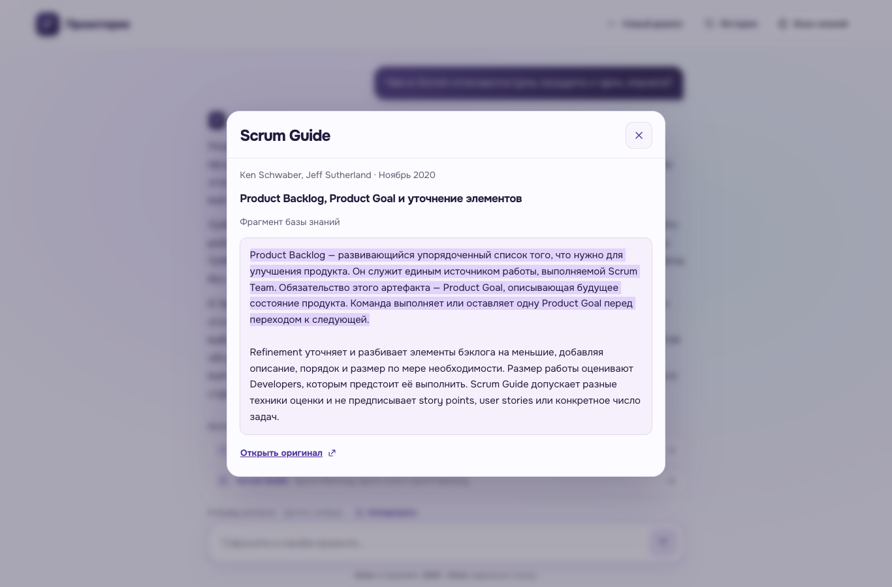

# Проектория

Веб-ассистент для студентов УрФУ. Он отвечает на вопросы о проектной работе по базе знаний о планировании, Agile, Scrum, Kanban, Git, CI/CD, требованиях и ГОСТах. По сноске открывается выдержка из конспекта и ссылка на первоисточник.

[Открыть Проекторию](https://projectoria.vercel.app)


Проект сделан в рамках кейса УрФУ «Разработка ИИ-ассистента для студентов на основе RAG-архитектуры и методологии проектной деятельности».

## Что попробовать

- **Agile.** Что такое Agile?
- **Scrum.** Чем отличаются Цель продукта и Цель спринта?
- **Техническое задание.** Какие разделы ТЗ на программу перечисляет ГОСТ 19.201-78?
- **Работа с задачами.** Что делать, если WIP-лимит заполнен и одна из задач заблокирована?
- **Продолжение диалога.** Если команда выбрала Scrum, спросите, за что отвечают её участники, а затем уточните, образуют ли frontend-разработчики отдельную подкоманду.

С вопросом вроде «Назначь роли моей команде» ассистент может показать общие правила из базы и спросить о результате, сроках и участниках. Для вопросов о расписании защиты и правилах курса нужны локальные документы УрФУ. В текущей базе собраны общие методики и стандарты.

## Как получается ответ

1. Поиск по словам и по смыслу находит подходящие разделы. Явное уточнение учитывает тему предыдущего вопроса.
2. DeepSeek формулирует ответ и подбирает цитату к каждому тезису. При нехватке сведений сервер может расширить поиск.
3. Сервер сверяет цитаты с базой и при необходимости запрашивает исправление. Сноски открывают выдержку и ссылку на оригинал.

В `knowledge/` лежат 11 конспектов, 52 фрагмента и готовый векторный индекс BGE-M3. [Как устроен поиск](docs/implementation.md#от-вопроса-к-источнику)

В интерфейсе есть чат, история диалогов и база знаний с поиском. История сохраняется в браузере. При уточнении OpenRouter получает текущий вопрос, исходный вопрос темы, до двух последних уточнений и отобранные фрагменты. При явной отсылке к прошлому ответу передаётся его начало. Размер входа ограничивается до отправки модели.

<details>
<summary>Как выглядит источник под ответом</summary>



</details>

## Запуск

Нужен Python 3.13. Чтобы включить чат, впишите `OPENROUTER_API_KEY` в `.env` после копирования шаблона и до запуска сервера.

**macOS и Linux**

```bash
python3.13 -m venv .venv
.venv/bin/python -m pip install -r requirements.txt
test -f .env || cp .env.example .env
.venv/bin/python -m uvicorn app.server:app --port 8000
```

**Windows PowerShell**

```powershell
py -3.13 -m venv .venv
.\.venv\Scripts\python.exe -m pip install -r requirements.txt
if (-not (Test-Path .env)) { Copy-Item .env.example .env }
.\.venv\Scripts\python.exe -m uvicorn app.server:app --port 8000
```

Откройте [локальную Проекторию](http://127.0.0.1:8000). Без ключа доступна база знаний. [Состояние API и модель](http://127.0.0.1:8000/api/health)

| Настройка | Значение по умолчанию |
| --- | --- |
| `OPENROUTER_CHAT_MODEL` | `deepseek/deepseek-v4.1-flash` |
| `OPENROUTER_EMBEDDING_MODEL` | `baai/bge-m3` |
| `OPENROUTER_RERANK_MODEL` | Пусто без переменной. В `.env.example` задан `qwen/qwen3-reranker-0.6b` |

## Проверка качества

В наборе 40 сценариев. Для каждого есть ожидаемые источники или поведение при нехватке сведений. Используйте Python из `.venv`.

```bash
python -m pip install -r requirements-dev.txt
python -m pytest -q
python scripts/build_index.py --check
python -m evaluation.run
```

Следующая команда получит ответы модели от запущенного чата с ключом.

```bash
python -m evaluation.run --url http://127.0.0.1:8000 --output output/evaluation/live.json
```

Отчёт сохраняет ответы, цитаты, результаты автоматических проверок и критерии для оценки содержания. [Методика оценки](docs/quality.md)

## Где что лежит

| Каталог | Содержимое |
| --- | --- |
| `app/` | Сервер FastAPI, поиск и сборка ответа |
| `app/static/` | Чат, сноски, история и просмотр документов |
| `knowledge/` | Конспекты, список источников и индексы |
| `evaluation/` | Вопросы и скрипт оценки |
| `scripts/` | Сборка текстового и векторного индексов |
| `tests/` | Автотесты сервера, поиска и проверки ответов |

[Как добавить документ и обновить индексы](knowledge/README.md)
